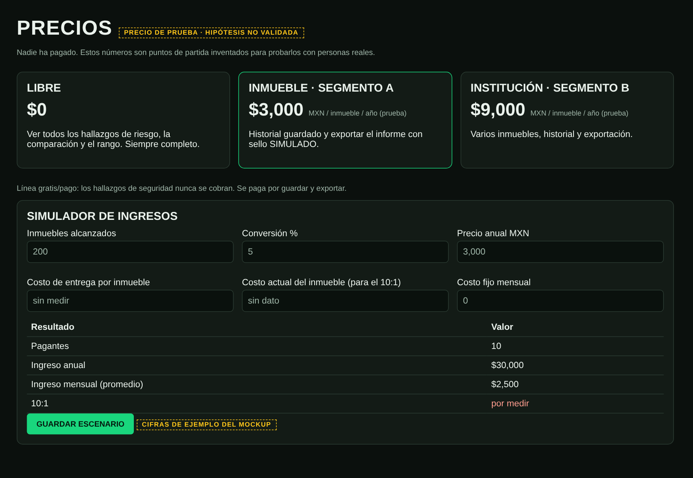
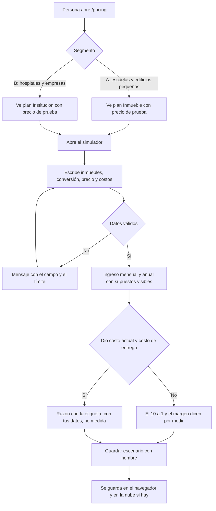
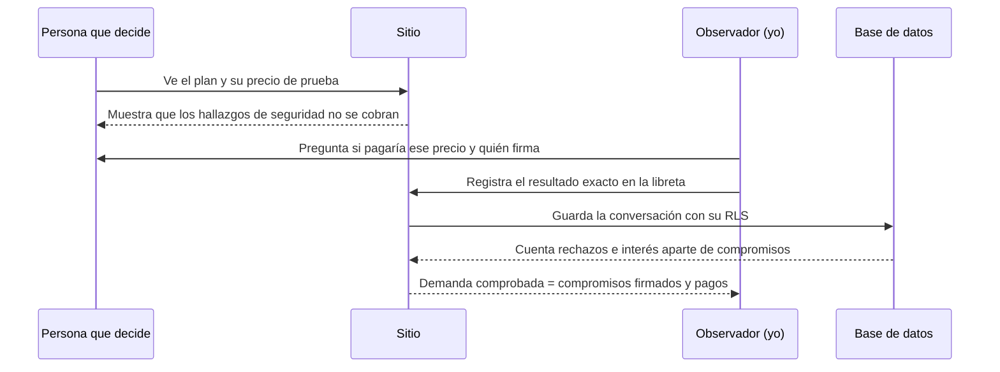

# PACKET: Croquis Vivo, semana 14 (precios)

*Individual · escrito antes del código de esta semana. Packet de la semana 13: docs/PACKET_W13.md. Blueprint de la semana 14 (equipo de cuatro, borrador basado en documentos, pendiente de ratificación en vivo): mi declaración es hablar con quien decide en un inmueble sobre su flujo actual de simulacros y probar un precio anual etiquetado, sin vender nunca una certificación. Condiciones 1, 3 y 4.*

## 1. El problema, en mis palabras
Una herramienta sin precio es un pasatiempo con URL. La semana pasada la herramienta aprendió a observar personas; esta semana necesita un número defendible: quién paga, cuánto, por qué unidad y cuál es la comparación honesta contra lo que se hace hoy. Mi debate de rol (ADVERSARY) dejó tres muertes posibles: casi nadie cumple el programa interno, quien usa no es quien firma el gasto y lo gratis que ya existe es el competidor. El precio tiene que sobrevivir a eso, y mientras no lo haya probado una persona real, se muestra como hipótesis.

## 2. El usuario exacto
Dos segmentos. **A:** escuelas privadas y edificios pequeños; firma el director o el dueño. **B:** hospitales, empresas y sitios con varios inmuebles; firma administración. Quien usa el simulador de ingresos soy yo (y el equipo) para jugar con los supuestos; quien ve /pricing es la persona que decide el gasto.

## 3. Definición de éxito
Antes de que cierre el módulo, en croquisvivo.xyz: (1) /pricing muestra 2 segmentos y 3 planes con la línea entre gratis y de pago dibujada a propósito, cada precio etiquetado como hipótesis; (2) el simulador convierte inmuebles, conversión y precio en ingreso mensual y anual con los supuestos visibles; (3) puedo guardar escenarios con nombre y volver a verlos; (4) /about trae el memo 10:1 en una página; (5) hay un registro de conversaciones de precio que separa rechazos, interés dicho, propuestas pedidas, compromisos firmados y pagos, y solo los dos últimos cuentan como demanda.

## 4. Mockup

Maqueta HTML estática hecha antes del código (no es una imagen generada por IA: no tengo generación de imágenes en este entorno). Las cifras que se ven son de ejemplo.

## 5. El flujo (Mermaid)

### 5.1 De una persona que ve el precio a un escenario guardado

### 5.2 Quién hace qué

## 6. La línea de comparación global
Lo mejor que existe en la Tierra para esto es NaviGate Prepared (EE. UU.): registro de simulacros, planos para primeros respondientes y planes de emergencia escolares; Capterra lo lista desde US$1,000 al año por usuario. El mío se localiza en que cobra por inmueble, no por usuario, en que los hallazgos de seguridad nunca se esconden detrás de un pago y en que el precio se muestra como hipótesis hasta que alguien real responda. Raptor y otros no publican precio (G2), lo que sugiere que el precio de este mercado se negocia, no se publica.

## 7. La visión a tres años (versión ligera)
Si esta rebanada funciona, el producto pasa de simular dos croquis de ejemplo a cargar el plano real de un inmueble y a guardar el historial de todos sus simulacros, con un informe que dice qué cambió entre uno y otro. A tres años, es el registro vivo de simulacros de un edificio, con varios inmuebles por institución y con la confirmación de lo que predijo contra lo que pasó. Nunca será una certificación ni cobrará por ello.

## 8. Lo que NO construyo
Pagos reales (no hay cobro, ni tarjetas, ni facturas), cuentas con correo o Google, ni cargar planos reales. No pongo formularios que pidan correo o teléfono. Tampoco prometo funciones que no existen: en /pricing cada función dice si ya existe o está por construir.

## 9. Arquitectura y stack
| Capa | Qué | Por qué |
|---|---|---|
| App | Next.js 16 (App Router), React 19, TypeScript | Es la misma base de la semana 13 |
| Lógica de precios | `src/lib/precios/modelo.ts`, funciones puras con pruebas | Se prueba sin navegador |
| Páginas | `/pricing` (planes y simulador), `/about` (memo 10:1) | Pedido del brief |
| Escenarios y conversaciones | Tablas `escenarios` y `conversaciones_precio` en Supabase con RLS | Cada persona ve solo sus filas; no hay datos personales |
| Respaldo | localStorage | Si la nube falla, el escenario no se pierde y la página lo dice |
| Despliegue | Vercel, repo de GitHub, croquisvivo.xyz | Regla del venture |

## 10. Plan de pruebas
- **Lógica:** pagantes, ingreso mensual y anual, margen, equilibrio y razón contra casos hechos a mano; entradas fuera de rango o con datos personales; escenarios sin costos dicen por medir.
- **Recorrido (Playwright):** /pricing carga; muestra 2 segmentos y 3 planes; cada precio dice hipótesis; guardar un escenario y verlo; un valor inválido da error legible; /about trae el memo y no afirma un 1:10 medido.
- **Seguridad:** sin secretos en el repo; RLS en las dos tablas; validación de largo y tipo; datos inventados y etiquetados.
- **Persona sintética:** una persona que decide el gasto recorre /pricing y el simulador; se registra dónde se confunde y se arregla lo peor.

## 11. Condiciones del Blueprint de la semana 14 y cómo las cubre este ship
| # | Condición | Cómo la cubro |
|---|---|---|
| 1 | Reconstruir la tarea actual antes de mostrar precio; identificar comprador, dueño del presupuesto, unidad, costo completo y siguiente acción | El registro de conversaciones empieza por la tarea de hoy y quién firma; el simulador pide el costo actual del inmueble |
| 2 | Rechazo, interés dicho, propuesta pedida y compromiso firmado o pagado, por separado | Cinco resultados distintos; solo compromiso firmado y pago cuentan como demanda |
| 3 | Costos y beneficios comparables; el 10:1 es hipótesis hasta medirse | La razón sale solo con datos que la persona escribe y dice "con tus datos, no medida" |
| 4 | Cláusula sombra: pagar no compra una respuesta engañosa ni un veredicto de seguridad | Los hallazgos siempre son gratis; no hay insignia de aprobado; todo dice SIMULADO |
| 5 | Consentimiento, privacidad y portabilidad | Sin datos personales; exportar escenarios y conversaciones a CSV y JSON |
| 6 | El precio debe cubrir el costo medido de entrega | El costo de entrega aparece como "sin medir"; no se afirma margen sin él |

## 12. Lo que falta y es mío
Una conversación real de precio con alguien que podría pagar, y escribir lo que dice tal cual; no tengo ninguna todavía. También el costo real que paga hoy un inmueble por su programa y simulacros en México (no encontré una fuente pública con precios en pesos).
