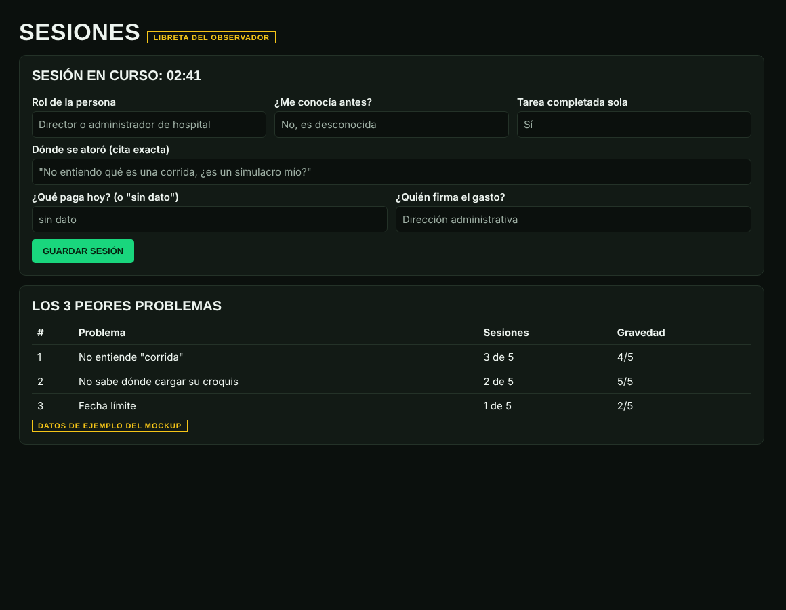
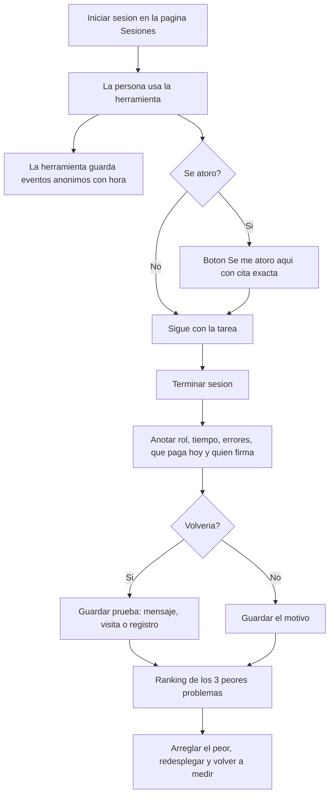
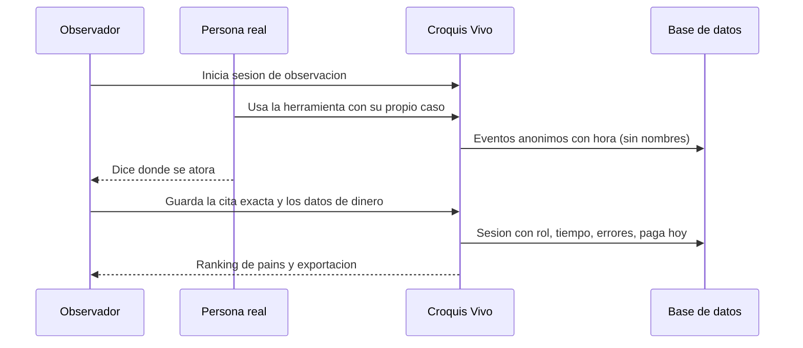

# PACKET: Croquis Vivo, semana 13 (usuarios reales)

*Individual · escrito antes del código de esta semana. Versión de la semana 12: `docs/PACKET_W12.md`. Blueprint de la semana 13 (equipo 5, borrador simulado pendiente de aprobación real): mis condiciones son la 3 (MONEY) y, por la regla de la semana, la 1 y la 6.*

## 1. El problema, en mis palabras

La herramienta de la semana 12 funciona, pero **que funcione no prueba que alguien la quiera ni que alguien la pague.** El Blueprint lo dice: el comportamiento del usuario y completar la tarea importan más que los comentarios positivos. Hoy no tengo ni una persona real que la haya usado. Esta semana el problema es de evidencia: poder **observar a cinco personas reales, medir qué hacen y dónde se atoran, y guardar lo que dicen que pagan hoy**, sin inventar nada.

## 2. El usuario exacto

Las personas que van a probar: coordinadores de Protección Civil, directores de escuela o administradores de hospitales, empresas o inmuebles (mínimo 3 de 5 desconocidos para mí). El usuario nuevo de esta semana es **yo como observador**: necesito una libreta que no deje que me olvide qué pasó en cada sesión.

## 3. Definición de éxito

> Antes de que cierre el módulo, puedo iniciar una sesión de observación, ver que la herramienta registra de forma anónima qué hizo la persona y cuánto tardó, anotar con una cita exacta dónde se atoró y qué paga hoy, ver el ranking de los tres peores problemas, y exportar todo a un archivo para el PDF. **Y el registro nunca presenta una opinión como evidencia de demanda.**

## 4. Mockup

*Maqueta HTML estática hecha antes del código (no es una imagen generada por IA: no tengo generación de imágenes en este entorno). Muestra la libreta de sesiones: datos de la persona por rol, tiempo, atascos con cita exacta, "qué paga hoy" y "quién firma el gasto".*

## 5. El flujo (Mermaid)

### 5.1 Una sesión de observación

### 5.2 Quién hace qué

## 6. La línea de comparación global

**Lo mejor que existe en la Tierra para esto es** el método de prueba de usabilidad con pocos usuarios de Nielsen Norman Group (observar a cinco personas, ranquear los problemas y arreglar los peores), aplicado en producto con herramientas de registro de sesiones como las que usa cualquier equipo de producto. **El mío se localiza en** que lo hace una sola persona, sin cámara y sin datos personales, con un campo propio para el dinero: qué paga hoy la persona y quién firma el gasto. Es la pregunta que el Blueprint me pide responder y que ninguna herramienta de usabilidad trae. *(Nota de honestidad: esta línea describe un método conocido y no una investigación nueva; no verifiqué una cifra de mercado.)*

## 7. La visión a tres años (versión ligera)

Si esta rebanada funciona, Croquis Vivo guarda para cada inmueble un historial de brechas encontradas, asignadas y confirmadas en simulacros reales. Los datos de uso reales se vuelven la calibración del modelo. El producto nunca será una certificación: es una ayuda para investigar, y las sesiones de observación son la forma en que se corrige cada versión.

## 8. Lo que NO construyo

Cuentas con contraseña, grabación de pantalla o cámara, análisis automático de comentarios, panel de gráficas bonitas, envío de mensajes a las personas, datos de contacto de las personas observadas, cualquier cifra de "satisfacción". El ranking de dolor lo calcula la libreta con lo que yo anoto y no con una opinión de "me gustó".

## 9. Arquitectura y stack

| Capa | Qué | Por qué |
|---|---|---|
| App | Next.js 16, React 19, TypeScript | Mismo stack de la semana 12 |
| Datos | Supabase nuevo (proyecto `croquisvivo`), inicio de sesión anónimo y RLS | Cada observador ve solo sus filas; sin datos personales |
| Tablas | `casos` (semana 12), `eventos` (registro anónimo), `sesiones` (libreta del observador) | Eventos y sesiones separados |
| Analítica | Registro propio de eventos, sin cookies de terceros ni scripts externos | Piso de seguridad: nada de datos personales |
| Despliegue | Vercel, repo de GitHub, dominio propio como URL de registro | Regla del venture |

## 10. Plan de pruebas

- **Mecánica:** pruebas automáticas de los validadores (longitud de citas, rangos de tiempo, roles permitidos), recorrido de Playwright de iniciar sesión, usar la herramienta, atascarse, cerrar y exportar, y que sin Supabase funcione con el navegador. Debe encontrar al menos un error real y arreglarlo.
- **Personas sintéticas (capa 1):** dos rondas más con Sofía y Héctor leyendo la página de sesiones y el botón de atasco.
- **Capa 2, lo que me falta hacer yo:** cinco sesiones con personas reales (mínimo tres desconocidas), el peor problema corregido y redesplegado con evidencia de antes y después, y una persona que vuelva con prueba.
- **Piso de seguridad:** sin llaves en el repo, RLS activa, entradas validadas, sin datos reales de personas.

## 11. Condiciones del Blueprint de la semana 13 y cómo las cubre este ship

| # | Condición | Qué hago |
|---|---|---|
| 1 | Valor real para el usuario (5 reales, 3 desconocidas; tarea, confusión, errores, tiempo) | La libreta mide justo esos cuatro campos; la parte de conseguir a las personas es mía y no está hecha |
| 3 | Caso económico creíble (quién decide la compra, costos actuales, evidencia de disposición a pagar; el 10:1 se mide) | Campos "qué paga hoy", "quién firma el gasto" y "cuánto tardó con su hoja de hoy"; el 10:1 queda **"por medir"** hasta tener datos |
| 6 | Iteración con evidencia: registrar fallas, corregir lo mínimo, volver a probar, conservar los resultados negativos | Cada sesión se guarda aunque salga mal y no se borra; el ranking incluye los negativos |
| Sombra | Nada simulado se presenta como verificado real | Se conserva: etiquetas y "confirmada" solo con simulacro real |

## 12. Lo que falta y es mío

Dominio propio; cinco personas reales; el arreglo del peor problema salido de sus palabras; una persona que vuelva con prueba; el video de demostración.
