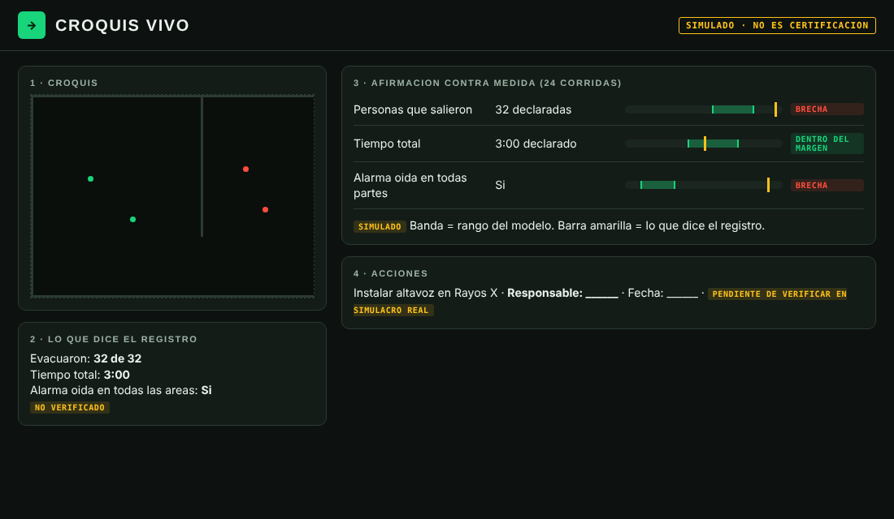
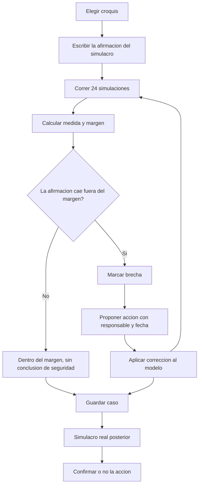
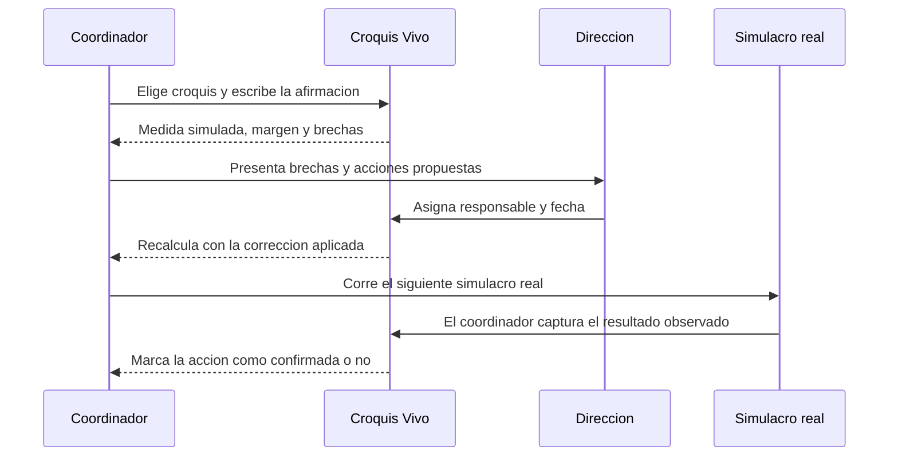

# PACKET: Croquis Vivo (Core Build)

*Semana 12 de AI 2041 · Venture: Croquis Vivo (semana 6, capítulo 5) · Individual, escrito antes de reconstruir.*

## 1. El problema, en mis palabras

Todo hospital, escuela y empresa en México debe tener un Programa Interno de Protección Civil y hacer simulacros. El registro típico de un simulacro dice cuántas personas salieron y en cuánto tiempo. No dice quién nunca oyó la alarma, qué estorbo alargó la ruta ni dónde se hizo fila. El registro es una **afirmación**, y nadie la compara contra una **medida**. Si hay un incidente real, la lista de firmas no prueba nada.

## 2. El usuario exacto

El coordinador de Protección Civil de un inmueble (hospital privado mediano o primaria pública en CDMX). Detalle en `docs/PERSONAS.md`. El segundo usuario es quien dirige el inmueble y decide qué corrección se aprueba.

## 3. Definición de éxito

> Antes de que cierre el módulo, un coordinador puede abrir el sitio, elegir un croquis, escribir lo que declaró su simulacro, ver **qué afirmaciones caen fuera del error normal del modelo**, asignar cada brecha a una persona con fecha, aplicar una corrección y ver el caso recalculado, y **guardar el caso** para volver a abrirlo. Todo lo simulado dice "simulado" y nada se presenta como verificado.

## 4. Mockup

*Mockup hecho antes de escribir código: una maqueta HTML estática de la pantalla central (afirmación contra medida, con rango y brecha), que fijó la identidad visual "Salida" (verde de salida de emergencia sobre fondo oscuro). No usé generación de imágenes por IA.*

## 5. El flujo (Mermaid)

### 5.1 Un caso, de principio a fin

### 5.2 Quién hace qué

## 6. La línea de comparación global

**Lo mejor que existe en la Tierra para esto es** Pathfinder, de Thunderhead Engineering: un simulador de evacuación por agentes con interfaz gráfica y revisión 2D y 3D, hecho para especialistas en modelado de evacuación y pensado para complementar su criterio, no reemplazarlo ([documentación oficial](https://www.thunderheadeng.com/docs/2025-1/pathfinder/introduction)).

**El mío cambia o se localiza en:** que no pide un especialista; parte de lo que **declaró el registro del simulacro** y lo compara contra la simulación con un margen de error explícito; y asigna cada brecha a una persona. A cambio, es menos preciso y no sirve como certificación.

*Lo que no encontré:* el precio de Pathfinder (la página no lo dice), así que no afirmo que el mío sea más barato. Tampoco encontré una guía oficial pública del formato de evaluación de simulacros; la guía de CENAPRED que revisé solo menciona el tema "Evaluación y control de simulacros" como parte de un curso.

## 7. Visión a 3 años (carta ligera)

Si la rebanada funciona, cada inmueble tiene un historial de casos: afirmaciones, brechas, acciones y simulacros reales que las confirmaron o no. El modelo se calibra con esos simulacros reales y avisa cuándo no está calibrado. Lo que no se vuelve nunca: una certificación ni un ranking de inmuebles.

## 8. Qué NO construyo

Editor de planos desde cero (se elige entre croquis de ejemplo y se ajustan estorbos y altavoces); certificación; alertamiento; humo o fuego; cuentas con datos personales; integración con Protección Civil; nada de "10×" que no esté medido.

## 9. Arquitectura y stack

| Capa | Qué | Por qué |
|---|---|---|
| App | Next.js 16 (App Router), React 19, TypeScript | Base conocida, deploy gratis en Vercel |
| Motor | Funciones puras: acústica, flujo, agentes, conjunto de 24 corridas y comparación | Sin IA que opine; reglas que calculan; con pruebas automáticas |
| Datos | Supabase (Postgres) con RLS por usuario anónimo; respaldo local si no hay conexión | Casos guardados sin datos personales |
| Seguridad | Sin llaves en el repo; formularios con validación; personas inventadas y marcadas | Piso de seguridad del curso |
| Dominio | Dominio real de la venture, conectado a Vercel | Es la URL de registro |

## 10. Plan de pruebas

- **Mecánica:** autoprueba del motor (acústica, rutas, agentes, margen, comparación, estados de acción) y Playwright contra el sitio en vivo: flujo completo, caso guardado y reabierto, celular de 390 px.
- **Persona sintética:** dos rondas con Sofía y Héctor (ver `docs/PERSONAS.md`) leyendo capturas en orden. Se registra cada confusión y se arregla la peor.
- **Condiciones del Blueprint:** página `/condiciones` con dónde se cumple cada una y cómo se comprobó. Mi condición es la 3: comparar la tarea completa contra la alternativa existente, sin inventar un 10×.
- **Condición para parar:** si la persona sintética no logra leer una brecha sin ayuda en dos rondas, se simplifica antes de agregar nada.
